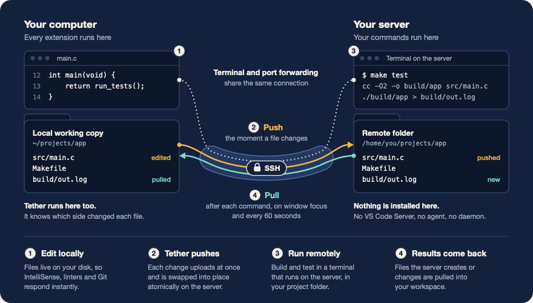

<p align="center">
  
</p>

# Tether — Lightweight SSH Sync

> **Modern local VS Code on legacy and shared servers.** Edit with your own extensions, toolchains, and Copilot/AI — sync over SSH, install nothing on the host.

[](https://marketplace.visualstudio.com/items?itemName=filippobrogi00.tether-sync)
[](https://marketplace.visualstudio.com/items?itemName=filippobrogi00.tether-sync)
[](https://marketplace.visualstudio.com/items?itemName=filippobrogi00.tether-sync&ssr=false#review-details)
[](https://open-vsx.org/extension/filippobrogi00/tether-sync)
[](LICENSE)

**Tether** is built for **legacy servers** and **hosts shared by many users** — CentOS 7, old login nodes, locked-down HPC boxes, small boards — where Remote - SSH cannot run or would crowd the machine. You keep an up-to-date VS Code (or Cursor / VSCodium) locally, with every extension, custom toolchain, and Copilot/AI feature you already use; the server only sees a normal SSH login and your project files.

<p align="center">
  
</p>

With Tether you can:

- **Use a current editor stack locally** — latest VS Code, your extensions, language servers, linters, formatters, custom toolchains, and GitHub Copilot or other AI assistants — while the code lives on a legacy or shared remote.
- **Keep** the server clean for everyone. Nothing is installed on it: no VS Code Server, no agent, no daemon, no per-user `~/.vscode-server` footprint.
- **Build, run, and test** in a terminal that executes on the server, and watch the output files appear in your workspace.
- **Keep working** when the connection drops. Offline edits are sent when it returns.
- **Use** the editor you prefer: VS Code, VSCodium, Cursor, Windsurf, and other editors built on VS Code.

## Getting Started

Install from the [Visual Studio Marketplace](https://marketplace.visualstudio.com/items?itemName=filippobrogi00.tether-sync) or [Open VSX](https://open-vsx.org/extension/filippobrogi00/tether-sync), or open Quick Open (`Ctrl+P` / `Cmd+P`) and run:

```text
ext install filippobrogi00.tether-sync
```

Then:

1. Click **Tether** in the status bar (bottom left), or run **Tether: Connect Folder…** from the Command Palette (`F1`).
2. **Choose a server.** Hosts from your `~/.ssh/config` are listed. You can also type `user@hostname`.
3. **Choose a folder on the server** by clicking through its directories — or, if you already have a local project open, pair that folder with one on the server.

Connecting starts continuous two-way sync. There is no configuration file to write.

## Why Tether

Remote - SSH moves your editor's backend onto the server. Tether leaves the editor where it is and moves only your files.

| | Tether | Remote - SSH |
|---|---|---|
| **Installed on the server** | Nothing | VS Code Server and every workspace extension, often hundreds of MB per user |
| **Server load while you work** | A brief file listing about once a minute, plus the transfers themselves | A Node.js server, the extension host, language servers, and file watchers |
| **Server requirements** | Any Linux or Unix host with SSH and SFTP | Kernel 4.18+, glibc 2.28+, libstdc++ 3.4.25+ ([details](https://code.visualstudio.com/docs/remote/linux)) |
| **When the connection drops** | Keep editing. Changes sync when it returns | The window waits until it reconnects |
| **Editors** | VS Code and editors built on it | Microsoft's VS Code |
| **Typing latency** | Local | Round trip to the server for many features |
| **Extensions see the server's toolchain** | No — they see your local files | Yes |
| **Run and Debug on the server** | From the server terminal | Built in |

Tether is worth trying if you have run into any of these:

- `GLIBC_2.28 not found`, or a warning that the host does not meet the prerequisites, on CentOS 7, RHEL 7, Ubuntu 18.04, or an old embedded image.
- `~/.vscode-server` eating your home directory quota on a shared machine.
- VS Code Server processes using CPU and memory on a login node or a small board.
- No Remote - SSH in your editor's extension gallery.
- Sessions that freeze or reload on a slow or unstable link.

If you need the editor to *be* on the server — for remote debugging or a repository too large to copy — Remote - SSH is the right tool. The two work well side by side.

## Legacy servers and shared hosts (`glibc >= 2.28`, Remote - SSH prerequisites)

Tether’s focus is **legacy OS images** and **multi-user servers**. When Remote - SSH fails with **"The remote host does not meet the prerequisites for running VS Code Server"** or a **`glibc >= 2.28`** / **`GLIBC_2.28 not found`** error (CentOS 7, RHEL 7, Ubuntu 18.04, and similar), you still get a modern local setup: current VS Code, local extensions, your own toolchains, and Copilot/AI — files sync over SSH with nothing installed on the host. Teams share one machine without each developer filling the disk with `~/.vscode-server` or running a Node IDE there.

## Features

### Stay in Sync — Two-Way File Sync

- **Push on every change.** Local changes are sent the moment a file changes, not only when you save, so `git checkout`, formatters, and scripts are covered too.
- **Pull when it matters.** Changes made on the server are picked up after each terminal command, when you return to the window, and once a minute.
- **Fast first connect.** Large one-sided trees are transferred as one compressed tar archive when `tar` is available, then fall back to per-file SFTP.
- **Compressed incremental transfers.** Larger file changes are gzip'd on the wire when the server has `gzip` (optional host `rsync` when present on both sides).
- **Skip what you do not need.** `.git/`, `node_modules/`, virtual environments, and caches are ignored out of the box. Add your own patterns in `.gitignore` syntax, in settings or in a `.tetherignore` / `.connectignore` file.
- **Pair two folders that already have files.** Identical files are matched by a SHA-256 hash computed on the server, so nothing is copied twice.

### Never Lose Work — Conflicts and Safety Nets

- **Conflicts are never overwritten.** When a text file changed on both sides, Tether opens the merge editor so you can accept or reject each change, then choose Keep mine, Keep the server's, or Keep both. Binary and delete conflicts stay whole-file only.
- **Deletions are deliberate.** A deletion is mirrored only for files that were in sync before. Files removed locally because they were deleted on the server go to your system trash.
- **Mass deletions ask first.** Removing more than 25 files in one sync needs your confirmation, and so does a side that suddenly looks empty. A folder that has gone missing (for example an unmounted disk) stops the sync instead of deleting everything.
- **Uploads are atomic.** Each file is written under a temporary name and renamed into place, so the server never sees half a file.
- **A changed host key refuses the connection.**

### Multi-user concurrency

Tether is safe when more than one person touches the same project folder:

- **You on Tether, someone else on the server** (SSH, vim, a build, another tool). Their edit shows up on the next pull (after a terminal command, when you refocus the window, or about once a minute). If you also changed that file locally, Tether marks a conflict instead of overwriting either side — for text, merge in the editor or keep a whole side.
- **Two people both on Tether.** Each syncs against the shared server copy. When the first user pushes, the second user’s next sync sees the server updated while their local file also changed — same conflict flow: merge editor for text, or keep yours / the server’s / both (`tether.conflictPolicy`).

### Run Where the Code Lives — Server Terminal, Remote View, and Port Forwarding

- **Remote Terminal** gives you a shell on the server, already inside the remote folder, kept alive with tmux or screen when available. Disconnect / close asks **Terminate** or **Keep alive**.
- **Remote View** adds a native second Explorer root (`tether:`) for drag-and-drop between local and remote.
- **Port forwarding** makes a web app or service running on the server available at `http://localhost:<port>`.
- **Results come back by themselves.** Logs, build output, and generated files are pulled into your workspace shortly after the command that created them.

### Sign In the Way You Already Do — SSH Config, Keys, and 2FA

- **Your SSH config is the configuration.** Hosts, users, ports, identity files, `Include` files, and `ProxyJump` chains are read from `~/.ssh/config`.
- **Every common sign-in works:** SSH keys, ssh-agent, key passphrases, passwords, and one-time codes (keyboard-interactive).
- **Host keys are verified** against your `known_hosts`. A first connection shows the fingerprint, and a changed key refuses to connect.

### Know Where You Stand — One Status Bar Item

| Status bar | Meaning |
|---|---|
| `✓ myserver: in sync` | Both sides are identical. |
| `⟳ myserver: syncing 3/40` | Files are being copied. |
| `⚠ myserver: 2 to review` | Files changed on both sides. Click to compare and choose. |
| `myserver: offline` | No connection. Keep working. Changes are sent when it returns. |
| `myserver: paused` | You paused syncing. Nothing is copied in either direction. |

Click the item for **Sync Now**, port forwarding, conflict review, the log, and everything else.

## Under the Hood

For every file, Tether records what both sides looked like the last time they agreed. On each sync it compares each side against that record, never the two sides against each other. Clock differences between machines therefore do not matter, and "deleted here" is never mistaken for "created there". Unison and Mutagen work the same way.

The server is listed with one `find` command when available (hundreds of thousands of files in one round trip) and over SFTP otherwise. First-time pairing of two non-empty folders compares SHA-256 hashes computed on the server, so identical files are never transferred. Cold one-sided syncs with many files use a single tar+gzip archive when possible.

| On your computer | On the server | Tether |
|---|---|---|
| Changed | Unchanged | Uploads your version |
| Unchanged | Changed | Downloads the server's version |
| Deleted | Unchanged | Deletes it on the server |
| Unchanged | Deleted | Moves your copy to the trash |
| Changed | Changed | Asks you |
| Deleted | Changed, or the reverse | Asks you |
| New | New, same content | Marks it as in sync without copying |
| New | New, different content | Asks you |

"Asks you" follows `tether.conflictPolicy`, so you can also let one side always win.

## Commands

All commands are in the Command Palette under **Tether**. Sync Now, port forwarding, conflict review, and the log also live in the status-bar menu.

| Command | Description |
|---|---|
| **Connect Folder…** | Pair a local folder with a server folder and start syncing. With an empty window, creates a local working copy first. |
| **Remote Terminal** | Open a shell on the server (tmux/screen when available), already in the project folder. |
| **Remote View** | Add a second Explorer root over the remote folder for drag-and-drop upload/download. |
| **Toggle Sync** | Pause or resume continuous syncing. |
| **Reconnect to Last Used Server** | Connect again using the pairing already saved for this folder. |
| **Disconnect** | Stop the session and skip auto-connect next time you open this folder (pairing is kept). |

### Reconnect behavior

- **Connection dropped** while working: status goes offline and Tether retries with backoff; local edits keep and sync when the link returns.
- **Quit VS Code** (or reload the window): you are asked whether to **Terminate** or **Keep alive** remote terminals (tmux/screen). Sync stops and the SSH session is closed. The folder pairing is kept with “resume on open”, so the next time you open that workspace it connects and syncs again automatically.
- **Disconnect**: same terminal prompt, then stops sync and turns off resume for that folder. Use **Reconnect to Last Used Server** (or Connect Folder…) when you want it again.

## Settings

> Tether works without any configuration. These settings are for fine-tuning.

| Setting | Default | Description |
|---|---|---|
| `tether.autoConnect` | **true** | Reconnect automatically when you open a folder that was still connected when you last quit. **Disconnect** opts out until you reconnect manually. |
| `tether.ignore` | *see below* | Files and folders that are never synced, in `.gitignore` syntax. A `.tetherignore` or `.connectignore` file in the project root is read as well. |
| `tether.respectGitignore` | **false** | Also skip everything listed in the project's root `.gitignore`. Off by default because ignored files such as `.env` are often needed on the server. |
| `tether.maxFileSizeMB` | **100** | Files larger than this are left alone on both sides. `0` removes the limit. |
| `tether.pollIntervalSeconds` | **60** | How often to look for changes made on the server. Local changes are always sent immediately. `0` turns periodic checks off. |
| `tether.conflictPolicy` | `"ask"` | What to do when a file changed on both sides: `ask`, `preferLocal`, `preferRemote`, or `keepBoth`. |
| `tether.confirmDeletesOver` | **25** | Ask before one sync deletes more than this many files. |
| `tether.concurrency` | **6** | How many files to transfer at the same time, from 1 to 16. |
| `tether.compressTransfers` | **true** | Gzip files above a size threshold before sending them over SSH. |

Ignored by default: `.git/`, `node_modules/`, `__pycache__/`, `.venv/`, `venv/`, `.mypy_cache/`, `.pytest_cache/`, `*.pyc`, `.DS_Store`, `Thumbs.db`.

> `.git/` is ignored on purpose. Use Git on your computer, where your Git extensions are.

## Requirements

**Your computer**

- VS Code 1.85 or later, or an editor built on it.
- Windows, macOS, or Linux.
- Nothing else. Tether speaks SSH and SFTP itself, so it needs no `ssh`, `scp`, or `rsync` on your machine.

**Your server**

- Any Linux or Unix host running an SSH server with SFTP enabled (the OpenSSH default).
- No root access, no installation, and no extra open ports.
- No kernel, glibc, or CPU architecture requirement — old distributions and small ARM boards are fine.

**Note:** Windows servers are not supported.

## Security

Tether copies files from the server onto your computer. Sync only with servers you trust, and keep Workspace Trust turned on: a hostile server could plant files (tasks, workspace settings) that tools on your machine would act on.

- **Host keys** are checked on every connection. Tether never edits your SSH files. Keys you accept are remembered in its own storage.
- **Passwords** are saved only if you choose **Remember**, and then only in your system keychain. Key passphrases are remembered for the current session only.
- **Your SSH config is read, never executed.** `Match exec` rules are not run.

See [SECURITY.md](SECURITY.md) to report a vulnerability.

## Known Limitations

Tether trades one thing for its light footprint: **your extensions see local files, not the server's environment.**

- Code intelligence for dependencies that exist only on the server (a Python environment, system headers) is incomplete unless you install them locally too.
- Run, build, test, and debug happen in the server terminal, not through the Run and Debug view.
- Symbolic links and empty folders are not synced.
- Files are transferred whole, without rsync-style deltas, so very large files that change often are a poor fit. Files over 100 MB are skipped by default.
- Permissions belong to the server. Set them there with `chmod` and they are kept on every upload.
- `ProxyCommand` in your SSH config is not supported yet. `ProxyJump` is.

## Troubleshooting

Run **Tether: Show Log** first (or open it from the status-bar menu). It records every connection attempt and every file Tether touched.

| What you see | What to do |
|---|---|
| "Could not sign in" | Check that `ssh user@host` works in a terminal, and that your key is loaded in ssh-agent or listed as `IdentityFile`. |
| "The identity of the host has CHANGED" | The server's key differs from the one you trusted. If the server was reinstalled, remove the old key with `ssh-keygen -R <host>` and reconnect. Otherwise, do not connect. |
| "Uses ProxyCommand" | Replace it with `ProxyJump` in `~/.ssh/config`. |
| A file never reaches the server | Check `tether.ignore`, `.tetherignore` / `.connectignore`, and `tether.maxFileSizeMB`. |
| The status bar shows "to review" | Open conflict review from the status-bar menu and choose a version for each file. |
| The status bar stays "offline" | Run **Tether: Reconnect to Last Used Server**. Your edits are safe and will be sent once connected. |

## Roadmap

- Delta transfers for large files.
- Symbolic links and empty folders.
- `ProxyCommand` support.

## Release Notes

See the [changelog](CHANGELOG.md).

## Contributing

Development setup, tests, and pull-request guidelines are in [CONTRIBUTING.md](CONTRIBUTING.md).

```bash
npm install
npm run build
npm test
# Press F5 in VS Code / Cursor to launch an Extension Development Host
```

`src/core/` has no dependency on VS Code and can be reused as a library or CLI.

- Search [existing issues](https://github.com/filippobrogi00/tether/issues) or [open a new one](https://github.com/filippobrogi00/tether/issues/new) for bugs and feature requests.
- Ask questions and share setups in [Discussions](https://github.com/filippobrogi00/tether/discussions).

## Telemetry

Tether collects no telemetry and makes no network connections other than to the servers you choose.

## License

[MIT](LICENSE)

Tether is an independent open-source project. It is not affiliated with or endorsed by Microsoft.
